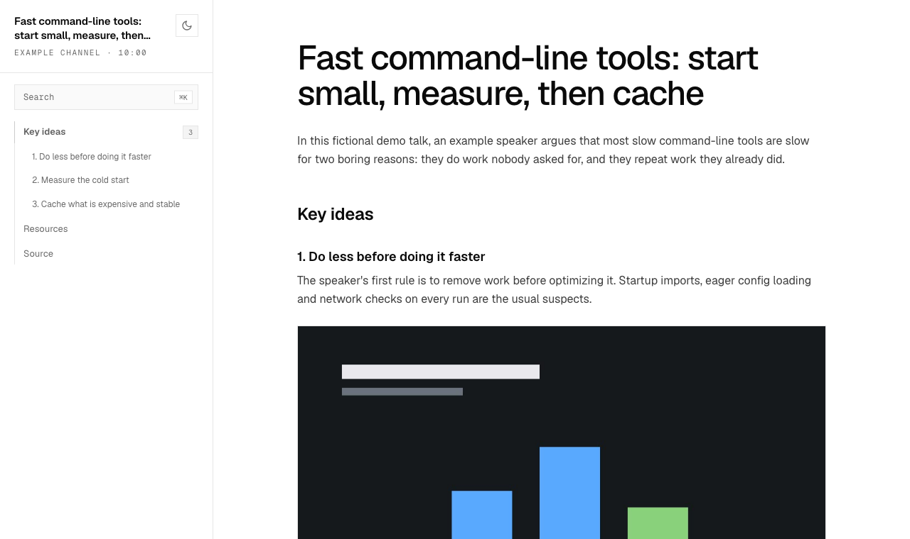
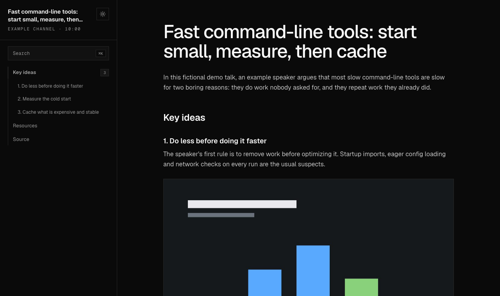

# talk-to-article

An agent skill that turns a recorded talk (a conference session, webinar, keynote or tutorial)
into a technical blog-style article. It places a screenshot of whatever the speaker is showing
next to the part of the text that explains it, and writes the result as one HTML page in its own folder.

Give your agent a YouTube or Vimeo link, a playlist or a local `.mp4`. It asks four quick
questions, then downloads the talk, reads the transcript, picks and crops the slides worth
showing, writes the article, checks it against the transcript and builds the page.

| Light | Dark |
|---|---|
|  |  |

*The screenshots show the fictional demo article in `tests/fixtures/demo/`.*

## What you get

One folder per talk, named after the talk and its video id:

```
~/talk-articles/design-will-never-be-the-same-na1OyJ3E7Kc/
├── index.html      # the article
├── images/         # screenshots, named by timestamp (0345.jpg = 03:45)
├── clips/          # optional GIFs / .mp4 clips
├── article.md      # the Markdown source the page is built from
├── transcript.md   # the talk's transcript, grouped by chapter
└── manifest.json   # options and metadata
```

The page includes:
- A fixed sidebar with the talk's title, a search box that looks through headings and section
  text, and a table of contents that highlights the section you're reading.
  Press ⌘K on macOS or Ctrl+K on Windows and Linux to jump to the search box.
- A light/dark theme toggle. It starts from the OS setting and remembers your choice.
- Under every screenshot, a caption with the timestamp, which links to that second of the video.
- Optionally, a table of the tools, commands and links the talk mentions, plus short GIFs or
  clips of live demos.
- A layout that reads well on phones. No external requests: fonts, styles and scripts are inline.

The page loads its images from the folder, so share the whole folder (for example as a zip),
not `index.html` on its own.

The article can be written in **Spanish, English or Portuguese**, whatever language the talk
is in. It can be a **full article** or an **executive summary**, written for **internal** use
or **external publication**. External publication follows stricter rules; see
[Responsible use](#responsible-use).

## Requirements

- Python 3.9+. The scripts only use the standard library.
- [`yt-dlp`](https://github.com/yt-dlp/yt-dlp) and [`ffmpeg`](https://ffmpeg.org/)
- An agent that can run shell commands and view images. The skill is written for Claude
  Code but stays agent-neutral. If the agent has a structured-question tool (such as
  AskUserQuestion), it asks the menu with that; otherwise it shows a numbered text menu.
- Optional: Whisper, only for videos without subtitles. For reading on-screen text without
  the agent's vision, the skill uses the OS's built-in OCR (macOS Vision, Windows.Media.Ocr)
  or Tesseract on Linux.

## Installation

This skill lives in the [Polaarts Skills](../../README.md) collection. Install it with the
[`skills`](https://github.com/vercel-labs/skills) CLI:

```bash
npx skills add polaarts/skills@talk-to-article
```

Or copy its folder into your skills folder by hand:

```bash
git clone --depth 1 https://github.com/polaarts/skills /tmp/polaarts-skills

# personal skill (all projects)
cp -R /tmp/polaarts-skills/skills/talk-to-article ~/.claude/skills/

# or project skill
cp -R /tmp/polaarts-skills/skills/talk-to-article .claude/skills/
```

Then check the dependencies. The second command installs whatever is missing with your OS's
package manager (Homebrew, apt/pip or winget):

```bash
python3 ~/.claude/skills/talk-to-article/scripts/setup.py
python3 ~/.claude/skills/talk-to-article/scripts/setup.py --install
```

## Usage

Ask your agent in plain words:

> Turn this talk into an article: https://www.youtube.com/watch?v=…

or invoke the skill directly with `/talk-to-article <url>`. Playlists and lists of URLs are
processed in batch with the same options.

Articles go to `~/talk-articles/`. When the article is done, the skill deletes the downloaded
video and intermediate files (`build.py --clean`). If you later want more screenshots, running
it again downloads the video again.

## How it works

The deterministic steps are scripts; the judgment is left to the agent.

| Step | Script | What it does |
|---|---|---|
| Download | `fetch.py` | Metadata, chapters, subtitles and the video (≤ 720p) |
| Transcript | `transcript.py` | Subtitles (or Whisper) → `transcript.md` by chapter |
| Frames | `frames.py` | Scene detection and periodic samples → contact sheets |
| Screenshots | `grab.py` | Frames at chosen times, with optional crop (picture-in-picture layouts) |
| Clips | `clip.py` | GIFs or `.mp4` clips of short moments |
| OCR | `ocr.py` | Native OCR fallback for slide text |
| Validate | `check.py` | Missing files, captions without timestamps, empty sections, placeholders, external-use rules |
| Build | `build.py` | `article.md` → `index.html`; `--clean` removes working files |

The agent writes the outline, chooses the screenshots, writes the article and runs a fidelity
review against the transcript. The guides it follows are in [`SKILL.md`](SKILL.md) and
[`references/`](references/).

## Responsible use

This tool downloads and quotes other people's work. You are responsible for how you use it:

- Respect the terms of service of the platform you download from and the rights of the
  speakers and event organizers. Some platforms don't allow downloading. Only process videos
  you are allowed to use.
- The skill does not bypass access controls. If a platform blocks a download (rate limits,
  bot checks, private videos), the skill stops; it never tries to get around it.
- **Internal use** (notes for you or your team) is the default.
- **External publication** turns on stricter rules: an attribution block that opens the
  article, condensed content, fewer screenshots, clips of 15 s or less, and no copy of the
  full transcript or video. See [`references/legal.md`](references/legal.md).
- Asking the speaker for permission, or tagging them when you publish, is good practice.

This is not legal advice.

## Development

The tests run offline and need neither ffmpeg nor network access:

```bash
python3 -m unittest discover tests
```

See [CONTRIBUTING.md](CONTRIBUTING.md).

## License

[MIT](../../LICENSE)
